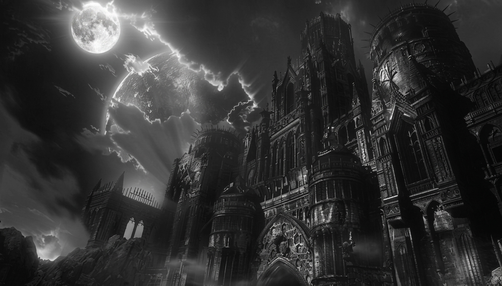
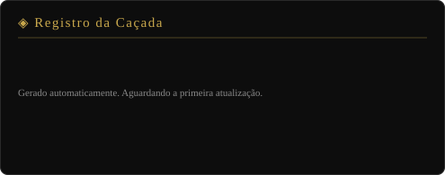
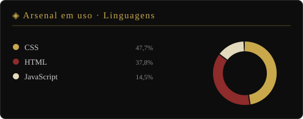
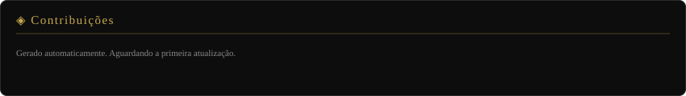
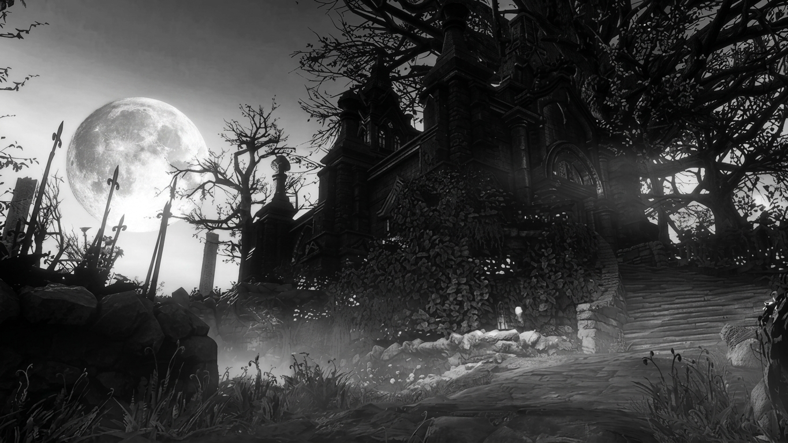
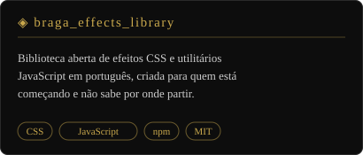
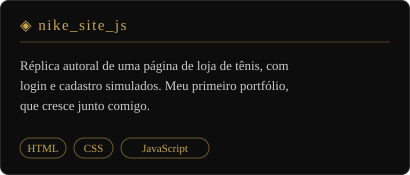

<div align="center">
  
</div>

<br/>

<div align="center">
  
</div>

<br/>

<div align="center">

[](https://www.linkedin.com/in/eduardo-braga-6131b9253/)
[](https://github.com/Braga93)

</div>

---

## O Registro do Caçador


> *"Nascemos do sangue, feitos homens pelo sangue, desfeitos pelo sangue."*

**Estudante de desenvolvimento full-stack** em Fortaleza, CE, construindo a base do ofício um projeto por vez: **HTML**, **CSS** e **JavaScript** no centro, com **Git** e **GitHub** no dia a dia.

Meus projetos vão de exercícios do curso até uma **biblioteca aberta de efeitos CSS**, que criei para quem está começando como eu comecei: perdido e sem rota. Os repositórios mais antigos ficam à mostra de propósito, porque mostram de onde eu parti e o quanto já andei.

Já estudei e domino **React**, **Node.js** e **Express.js**.

```
◈  Classe        →  Desenvolvedor Full-Stack (Front-End · Back-End)
◈  Origem        →  Fortaleza, Brasil 🇧🇷
◈  Aliança       →  Código aberto
◈  Atributos     →  INT / DES / FOR
◈  Equipamento   →  JS · React · Node · Express · Cypress
◈  Situação      →  Caçando bugs. Recusando-me a ficar oco.
```

<br clear="right"/>

---

## ⚔️ Arsenal — Tecnologias

<div align="center">


</div>

---

## 📊 O Registro da Caçada — Estatísticas

<div align="center">
  
  
</div>

---

## 📜 Contribuições

<div align="center">
  
</div>

---

<div align="center">
  
</div>

---

## 🕯️ Fogueiras Acesas — Formação

| | Curso | Onde | Situação |
|:---:|:---|:---:|:---:|
| ◈ | HTML5 | Digital College | ✅ Concluído |
| ◈ | CSS | Digital College | ✅ Concluído |
| ◈ | JavaScript | Digital College | ✅ Concluído |
| ◈ | React | Plataforma | ✅ Concluído |

---

## 🗡️ Grimório — Projetos em Destaque

<div align="center">
  <a href="https://github.com/Braga93/braga_effects_library"></a>
  <a href="https://github.com/Braga93/nike_site_js"></a>
</div>

<div align="center">

[Ver todos os repositórios →](https://github.com/Braga93?tab=repositories)

</div>

---

<div align="center">

*† Nascemos do sangue. Feitos homens pelo sangue. Desfeitos pelo sangue. †*

<br/>

*† Busque o Sangue Pálido para transcender a Caçada †*

</div>
